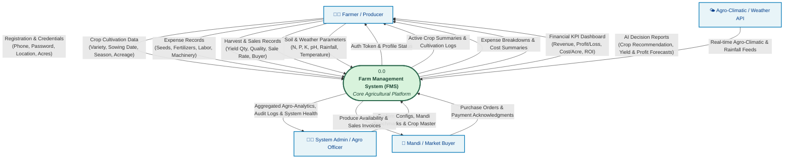
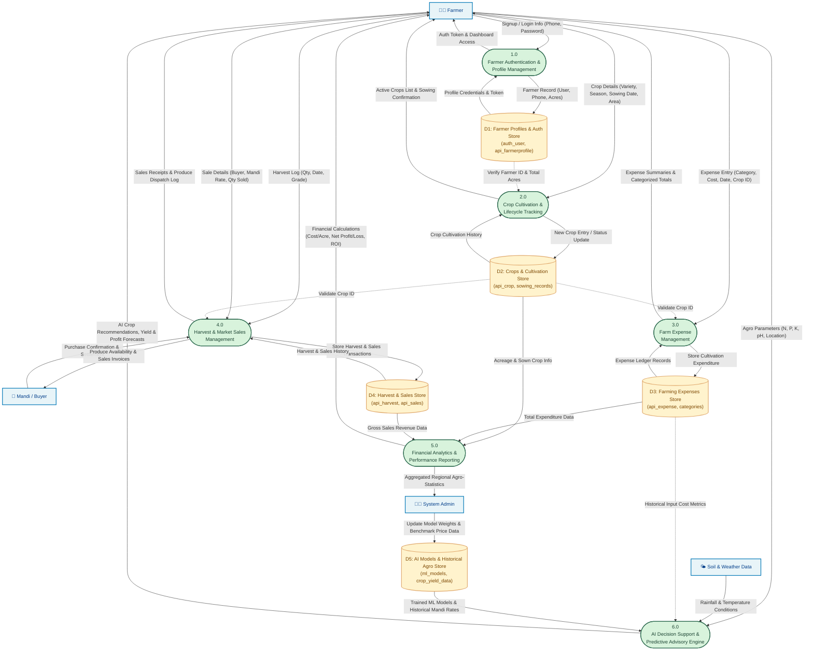
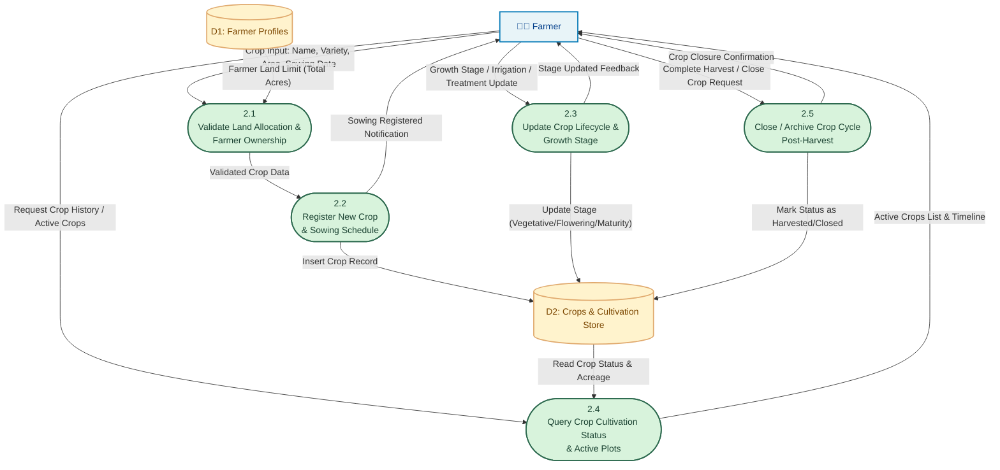
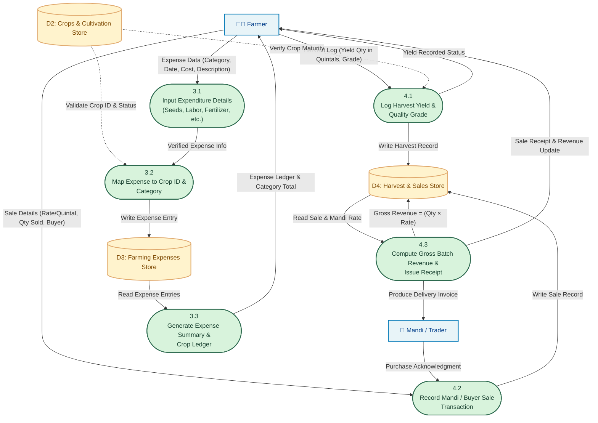
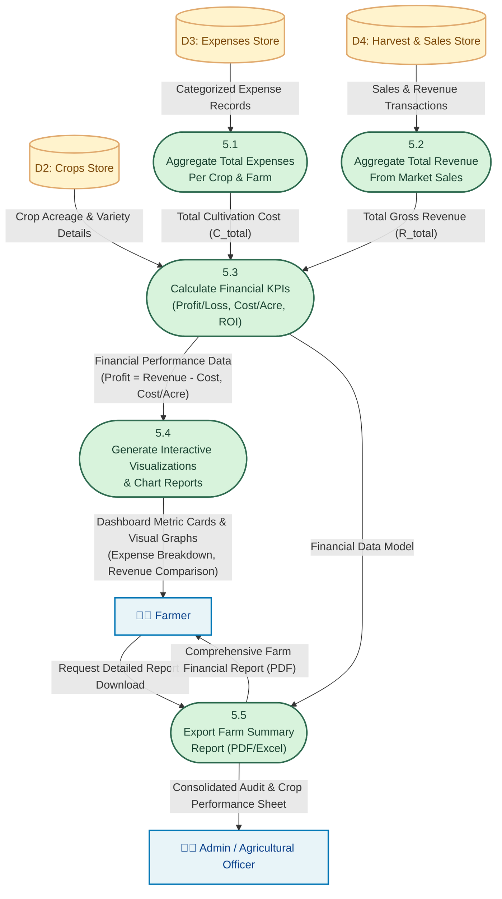
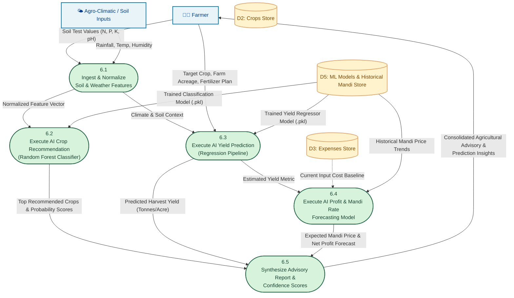

# Data Flow Diagrams (DFD) - Farm Management System (FMS)

**Project:** Farm Management System (FMS)  
**Academic Level:** MCA-II Project Documentation  
**Team Leader:** Sonali Bhauso Vidure  
**Team Member:** Shraddha Suresh Gurav  
**Architecture:** Django REST Framework + React.js + MySQL + Scikit-Learn  

---

## 1. DFD Notation Reference (Gane-Sarson / Yourdon & DeMarco)

| Element | Symbol / Representation | Description |
| :--- | :--- | :--- |
| **External Entity** | `[Entity Name]` (Rectangle) | External sources or destinations of data (e.g., Farmer, Market Buyer, Admin, Weather Service). |
| **Process** | `((Process Name))` or `([P# Process])` (Circle / Rounded Rectangle) | Operations, calculations, and transformations applied to data. |
| **Data Store** | `[("D# Store Name")]` (Open Rectangle / Cylinder) | Data storage repositories (e.g., MySQL Database tables, ML models). |
| **Data Flow** | `── Label ──>` (Directional Arrow) | Path along which data moves between entities, processes, and stores. |

---

## 2. Level 0 DFD (Context Level Diagram)

The **Context Diagram (Level 0 DFD)** represents the entire Farm Management System as a single centralized process bubble (`0.0`), identifying system boundaries, external actors, input flows, and output flows.

---

## 3. Level 1 DFD (System Overview & Functional Decomposition)

The **Level 1 DFD** decomposes Process `0.0` into the six fundamental operational sub-processes of the Farm Management System and connects them with data stores (`D1` through `D5`).

---

## 4. Level 2 DFDs (Detailed Sub-Process Decomposition)

### 4.1 Level 2 DFD: Process 2.0 (Crop Cultivation Management)

This diagram details crop registration, land allocation verification, growth tracking, and archiving.

---

### 4.2 Level 2 DFD: Process 3.0 & 4.0 (Expense Tracking, Harvest & Sales Management)

This diagram details operational workflows handled during farm maintenance and marketing of produce.

---

### 4.3 Level 2 DFD: Process 5.0 (Financial Analytics & Reporting Engine)

This diagram details the core business logic of Phase 6 & 7: calculating cost per acre, total revenue, net profit/loss, and rendering charts.

---

### 4.4 Level 2 DFD: Process 6.0 (AI Decision Support & Predictive Modeling)

This diagram details the Phase 8 AI/ML engines: Crop Recommendation (Classification), Yield Prediction (Regression), and Profit Forecasting.

---

## 5. Data Dictionary (Entities, Stores & Data Flows)

### 5.1 External Entities

| Entity ID | Entity Name | Description | Key Inputs Provided | Key Outputs Received |
| :--- | :--- | :--- | :--- | :--- |
| **E1** | **Farmer** | Primary end-user operating agricultural land. | Phone, password, crop info, expense vouchers, harvest/sales entries, soil data. | Auth token, KPI dashboard, crop schedule, expense breakdown, AI advisory. |
| **E2** | **System Admin** | Agricultural administrator / technical manager. | System configuration, crop reference master, price benchmarks. | System health metrics, user statistics, aggregated agro-reports. |
| **E3** | **Mandi / Buyer** | Wholesale APMC trader or private produce purchaser. | Purchase confirmation, price bids, payment settlements. | Crop availability notices, dispatch notes, sales receipts. |
| **E4** | **Agro / Weather API** | External meteorological and agricultural sensor data service. | Historical & live rainfall, temperature, relative humidity. | Query parameters (latitude, longitude, date range). |

### 5.2 Data Stores

| Store ID | Store Name | Physical Tables / Files | Key Attributes |
| :--- | :--- | :--- | :--- |
| **D1** | **Farmer Profiles & Auth Store** | `auth_user`, `api_farmerprofile`, `authtoken_token` | `id`, `username`, `phone`, `password_hash`, `location`, `total_acres`, `created_at` |
| **D2** | **Crops & Cultivation Store** | `api_crop`, `api_sowingrecord` | `crop_id`, `farmer_id`, `crop_name`, `variety`, `season`, `sowing_date`, `allocated_acres`, `status` |
| **D3** | **Farming Expenses Store** | `api_expense`, `api_expensecategory` | `expense_id`, `crop_id`, `farmer_id`, `category` (seeds, fertilizer, labor, machinery), `cost`, `date`, `description` |
| **D4** | **Harvest & Sales Store** | `api_harvest`, `api_sale` | `harvest_id`, `crop_id`, `yield_quantity`, `grade`, `sale_id`, `buyer_name`, `quantity_sold`, `rate_per_quintal`, `revenue`, `sale_date` |
| **D5** | **AI Models & Agro Dataset** | `crop_rec_rf.pkl`, `yield_reg.pkl`, `mandi_trends.csv` | Feature vectors (N, P, K, pH, rainfall, temp), model weights, historic price time series |

### 5.3 Key Data Flows

| Data Flow Name | Source | Destination | Key Data Elements |
| :--- | :--- | :--- | :--- |
| **Farmer Registration** | Farmer | Process 1.0 | Full Name, Phone Number, Password, Location, Total Acres |
| **Authentication Token** | Process 1.0 | Farmer | 40-character DRF Token, Profile JSON, Session Status |
| **Crop Cultivation Data** | Farmer | Process 2.0 | Crop Name, Hybrid Variety, Sowing Date, Area in Acres, Kharif/Rabi Season |
| **Expense Record** | Farmer | Process 3.0 | Crop ID, Expense Category, Amount (₹), Date, Notes |
| **Harvest Log** | Farmer | Process 4.0 | Crop ID, Harvest Date, Total Yield (Quintals/Tonnes), Quality Grade |
| **Sales Record** | Farmer | Process 4.0 | Crop ID, Buyer Name, Quantity Sold, Rate per Quintal (₹), Total Revenue |
| **Financial KPIs** | Process 5.0 | Farmer | Total Expenses, Gross Revenue, Net Profit/Loss, Cost per Acre, Profit per Acre, ROI (%) |
| **Soil & Climatic Inputs** | Farmer / Sensor | Process 6.0 | Nitrogen (N), Phosphorus (P), Potassium (K), Soil pH, Rainfall (mm), Temp (°C), Humidity (%) |
| **AI Advisory Output** | Process 6.0 | Farmer | Recommended Crop List, Confidence %, Predicted Yield (Tonnes/Acre), Forecasted Profit (₹) |
